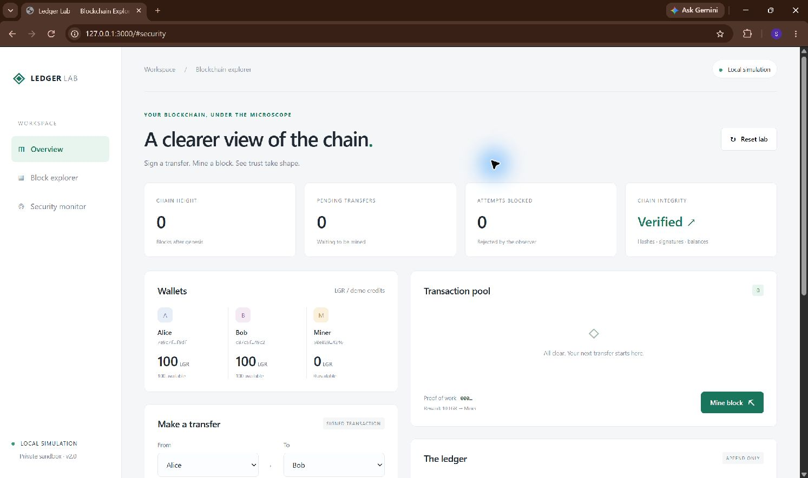

# Blockchain Double-Spending Detection

**Shreya Gajjar**

This project shows how a blockchain can detect an attempt to spend more money than a wallet has. It began as a JavaScript console project during my 2024 internship. I have since updated the code and added a dashboard to make the process easier to run and explain.

## Earlier version

The first version used signed transactions, block mining, a network observer, and peer alerts. It checked suspicious payments and showed the results in the terminal. Its response to an attack involved removing transactions and changing block links.

## Changes I made

| Earlier version | Updated version |
| --- | --- |
| Results were shown only in the terminal. | Added a dashboard for wallets, transfers, blocks, and alerts. |
| Pending payments could reuse the same balance. | Pending transfers now reserve funds, so a second payment cannot spend them again. |
| Attack handling changed existing blocks. | Invalid transfers are rejected before mining. Confirmed blocks stay unchanged. |
| Transaction checks were incomplete. | Added checks for signatures, amounts, repeated transactions, and transaction order. |
| Mining and pending transactions needed fixes. | Each block gets its own transaction list, the pool clears after mining, and the miner receives a reward. |
| The signing code used external libraries. | Switched to Ed25519 signatures and SHA-256 hashing with Node.js. |
| Setup and testing were incomplete. | Added run instructions, VS Code launch options, and 9 automated tests. |

## Example result

In the console demo, Alice starts with 100 credits and sends 70 to Bob. A second payment of 70 is blocked because only 30 credits remain available. After mining, Alice has 30, Bob has 70, and the miner receives 10. The chain passes validation, and all 9 tests pass.

## Screenshots

### Console demo and test results

The output shows the blocked payment, final balances, chain validation, and passing tests.


### Dashboard

The dashboard shows wallet balances, pending transfers, and the blockchain status before a transaction is submitted.



## Run the project

You need Node.js 20 or newer. No extra packages are required.

```sh
cd code
node main.js
```

Run the tests:

```sh
node --test test/blockchain.test.js
```

Start the dashboard:

```sh
node server.js
```

Open http://127.0.0.1:3000 and keep the server running. In VS Code, open the `code` folder and choose a Ledger Lab option from **Run and Debug**.

## Project report

[Read the blockchain section of the original report](docs/REPORT-TEXT.md). Only Chapter 5, Project II, is included. The unrelated internship and IoT sections have been removed from this version.

[Changes in more detail](docs/IMPLEMENTATION.md) · [Run output](evidence/run-output.txt) · [Project background](docs/SOURCE.md)

## Current limits

This is a learning project with simulated credits. It runs on one computer, does not connect to a real cryptocurrency network, and keeps its data in memory. Restarting the server resets the wallets and blockchain.
