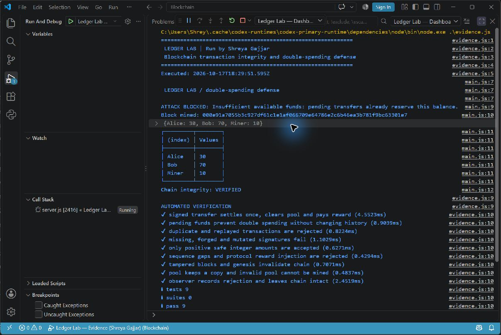

# Ledger Lab — Blockchain Double-Spending Defense

**Shreya Gajjar · Educational blockchain project**

An executable JavaScript blockchain lab with signed transfers, proof-of-work mining, pending-balance reservations, and a live double-spending demonstration. Includes a local dashboard, a console demo, and automated tests.

This repository connects the original April 2024 internship report with the revised Ledger Lab implementation. The historical report describes the earlier observer/peer-alert model; the revised code prevents conflicting spending before mining and never rewrites confirmed blocks.

## Run

Install Node.js 20 or newer. No third-party packages are needed.

```sh
cd code
node main.js
node --test test/blockchain.test.js
node server.js
```

For the dashboard, open http://127.0.0.1:3000 while `node server.js` remains running. Alternatively, open `code/` in VS Code and select **Ledger Lab — Dashboard** under Run and Debug. The portable launch configuration uses `node` from your PATH.

To reproduce the named execution output:

```sh
cd code
node evidence.js
```

The banner identifies the run as **Run by Shreya Gajjar**. It identifies the demonstrator, rather than claiming that a screenshot establishes source-code authorship.

## Verified demonstration

Alice starts with 100 LGR. A signed transfer of 70 LGR reserves her funds. A second transfer of 70 LGR is rejected. Mining confirms the first transfer and awards 10 LGR to Miner.

| Wallet | Final balance |
| --- | ---: |
| Alice | 30 LGR |
| Bob | 70 LGR |
| Miner | 10 LGR |

The current local execution completed successfully and **9 automated tests passed**. The exact run output, timestamps, mined hash, and test results are in [evidence/run-output.txt](evidence/run-output.txt). Timing and block hashes vary on every run.

## Revised implementation

- SHA-256 block hashes with previous-block links and proof of work.
- Ed25519 signatures using Node's built-in cryptography.
- Transaction IDs, per-sender sequence numbers, and replay rejection.
- Pending transfers reserve funds immediately.
- Positive safe-integer amount checks and signature validation.
- Transaction-pool isolation, pool validation before mining, and mining rewards.
- An observer log records accepted and blocked transfers without deleting confirmed history.
- A responsive dashboard with wallets, a transaction pool, a block explorer, and an attack simulation.

## Repository guide

| Path | Contents |
| --- | --- |
| `code/` | Revised runnable application, dashboard, tests, and VS Code launch settings |
| `evidence/run-output.txt` | Actual execution transcript, including the named banner and test results |
| `docs/DESIGN.md` | Historical design described in the original report |
| `docs/FIGURES.md` | Historical report figure notes |
| `docs/SOURCE.md` | Report attribution and implementation history |
| `docs/IMPLEMENTATION.md` | Changes and limits of the revised implementation |

The full original Word report remains in the supplied local project files; its GitHub upload is pending. A genuine VS Code execution screenshot is shown below. The text log is a separate run and may show different timing and hashes.

## Scope

This is a single-process, in-memory educational simulation using demonstration credits and server-managed wallets. It has no peer-to-peer consensus, production wallet authentication, real currency, or durable storage. Restarting the server resets the ledger. The local browser preview has not been visually verified. Unit tests do not establish production security or distributed double-spending resistance.

## Original project context

The original report, **Preventing Double Spending Attacks in Cryptocurrency Blockchains Using Network Observer and Peer-Alert System**, was submitted by **Shreya Gajjar** for the Computer Engineering internship at GTU Graduate School of Engineering and Technology, January–April 2024. Existing report notes and repository history are retained. See [source and attribution](docs/SOURCE.md).

## Execution screenshot



This is an unmodified capture of VS Code’s Debug Console, rather than a fabricated terminal image. The named banner identifies the demonstration runner. See [the text-only original report](docs/REPORT-TEXT.md) for historical context; figures and page layout remain in the original Word file.

