# Figure Walkthrough

All 18 figures below are extracted from the blockchain chapter of Shreya Gajjar’s April 2024 internship report. Images are resized for web display. They are report evidence; the implementation has not yet been uploaded or independently run here.

## Figure 5.1 — Transaction process

Background transaction-process illustration reproduced from the report.

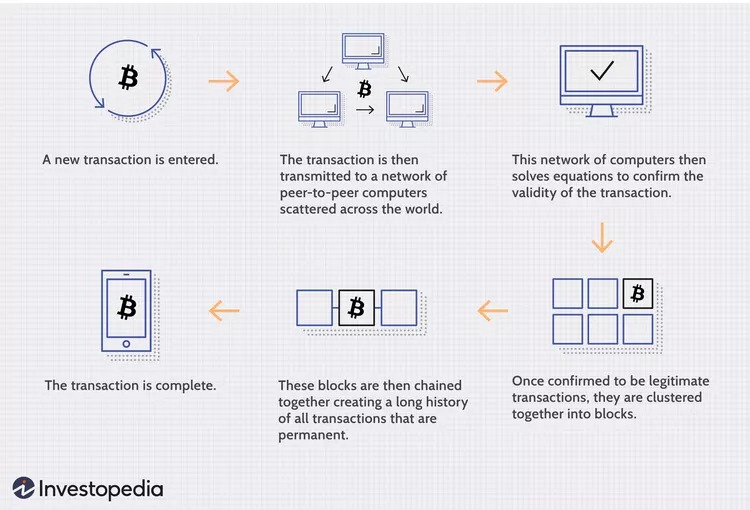

## Figure 5.2 — Blockchain architecture

Background blockchain architecture reproduced from the report.

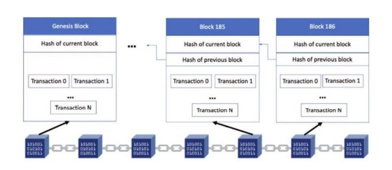

## Figure 5.3 — Model overview

Overview of the model used in the report.

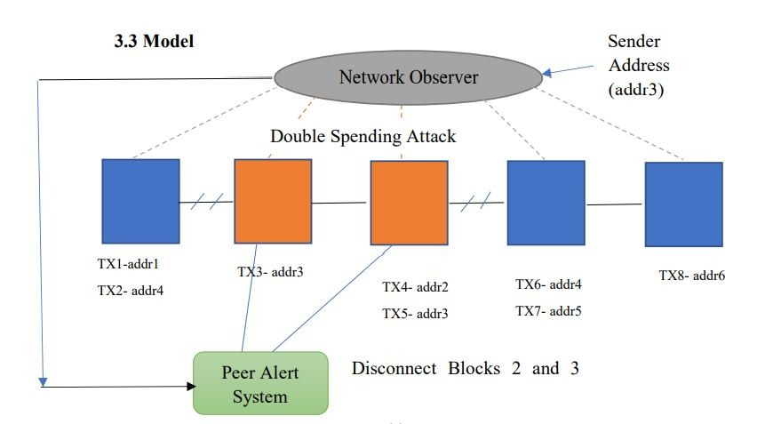

## Figure 5.4 — Initial blockchain output

Console output for the documented blockchain entry point.

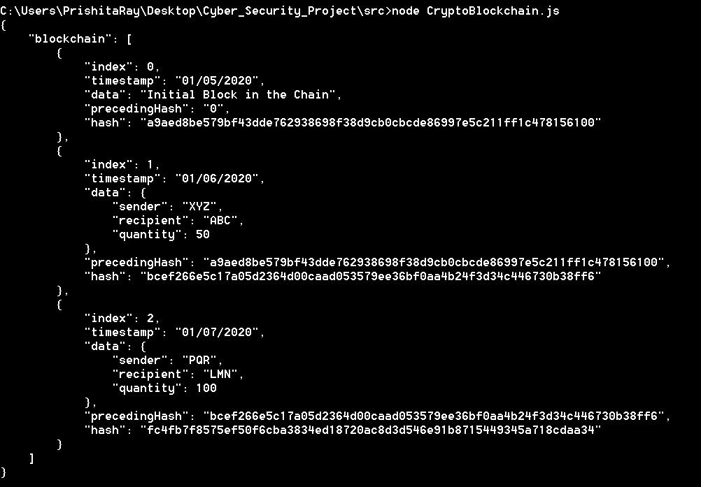

## Figure 5.5 — Nonce and mining difficulty

The report highlights random nonces and the mining difficulty requirement.

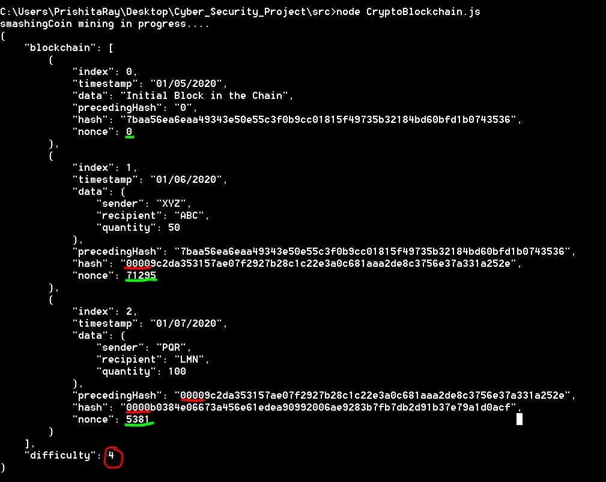

## Figure 5.6 — Chain validity before tampering

The demonstration reports a valid chain before data modification.

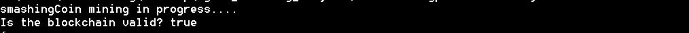

## Figure 5.7 — Chain validity after tampering

Changing a transaction amount causes chain validation to return false.

## Figure 5.8 — Mining reward

Console output illustrating the prototype mining reward.

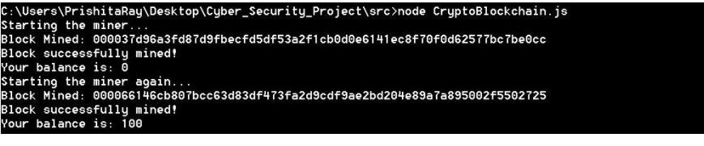

## Figure 5.9 — Signed transaction

Demonstration output for signing and processing a transaction.

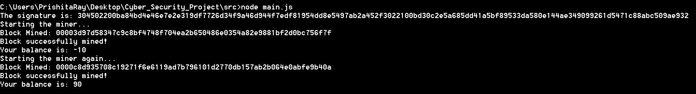

## Figure 5.10 — Conflicting pending transactions

Two pending payments share a sender and exceed the example balance.

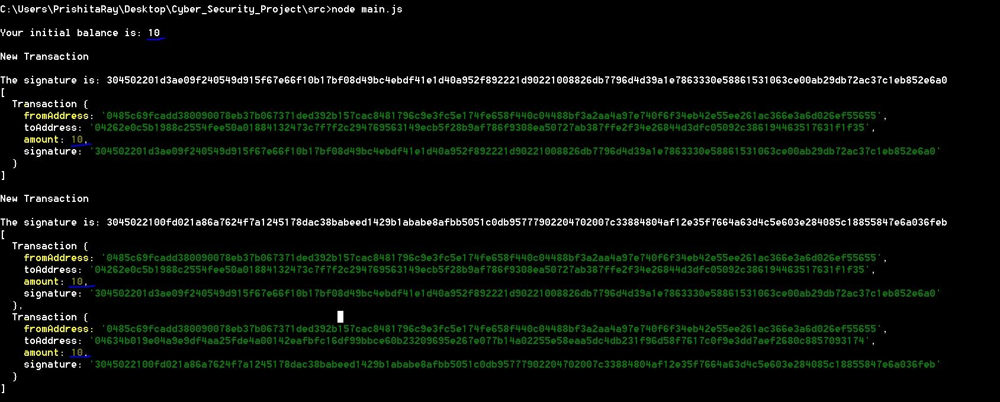

## Figure 5.11 — Observer rejection message

The observer prints an abort message for suspected double spending.

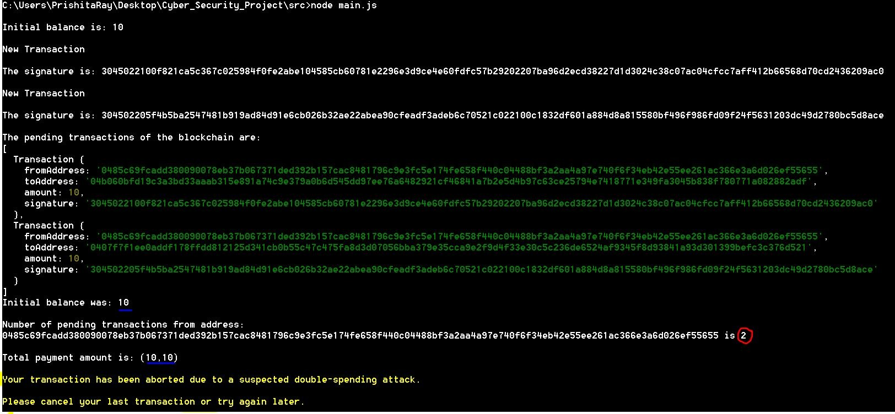

## Figure 5.12 — Four pending transactions

The peer-alert walkthrough begins with four pending transactions.

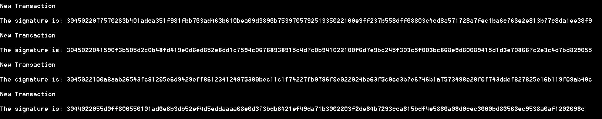

## Figure 5.13 — Chain with genesis block

The report displays the initial chain and its genesis block.

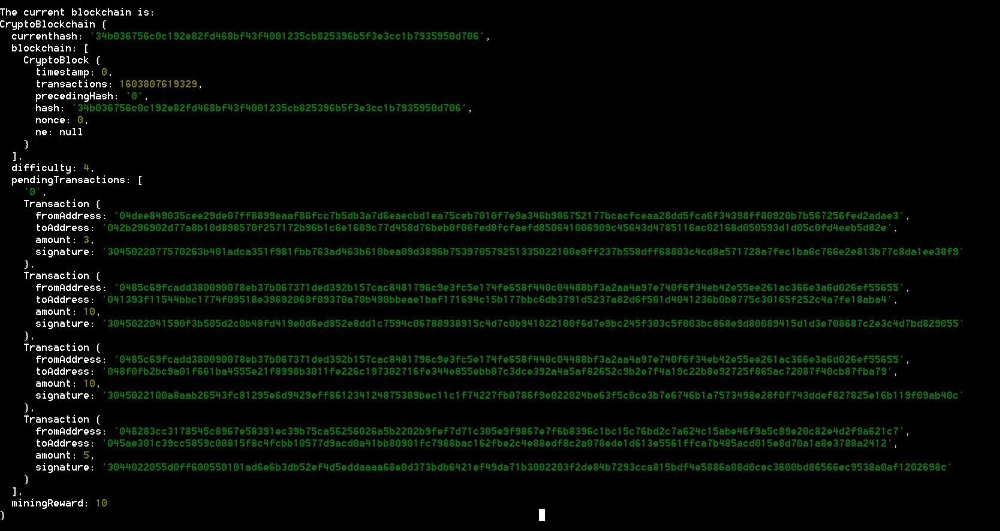

## Figure 5.14 — Mining pending transactions

Console output from mining the demonstration transactions.

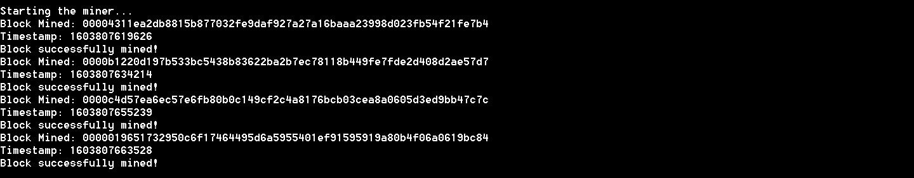

## Figure 5.15 — Double-spending warning

The report shows a suspected double-spending warning and response.

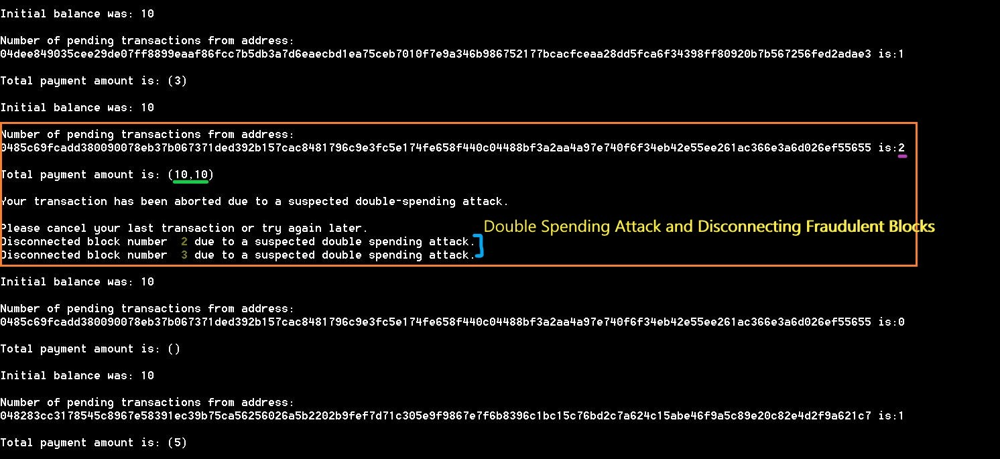

## Figure 5.16 — Pending transactions reduced to two

The walkthrough removes two suspicious transactions, leaving two.

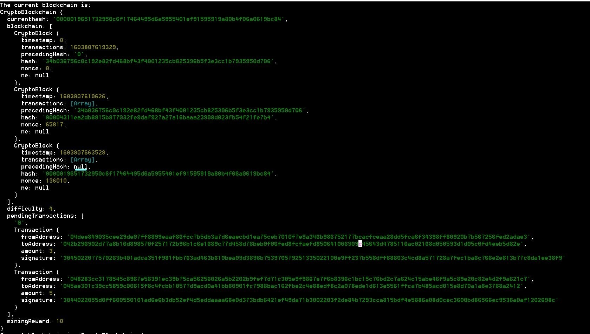

## Figure 5.17 — Prototype genesis replacement

The prototype replaces a affected block with a new genesis block. This is a model-specific demonstration, not a production consensus mechanism.

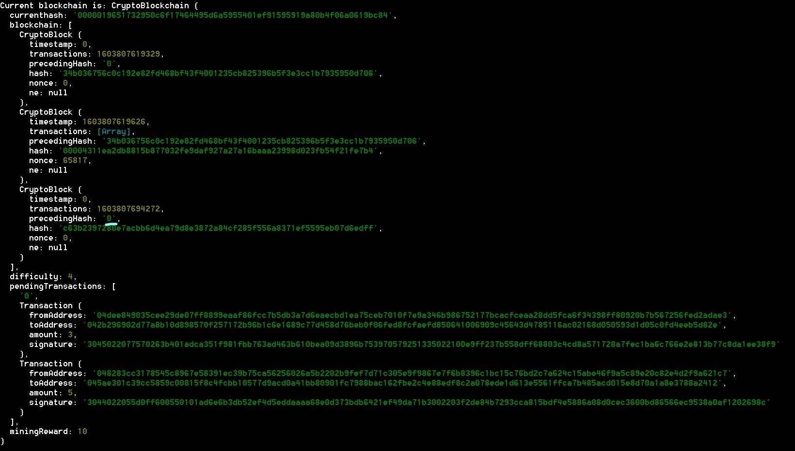

## Figure 5.18 — Updated address balances

Balances displayed after the remaining transactions are processed.

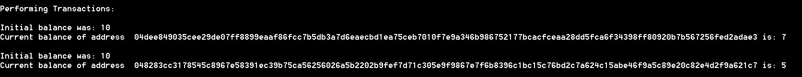

